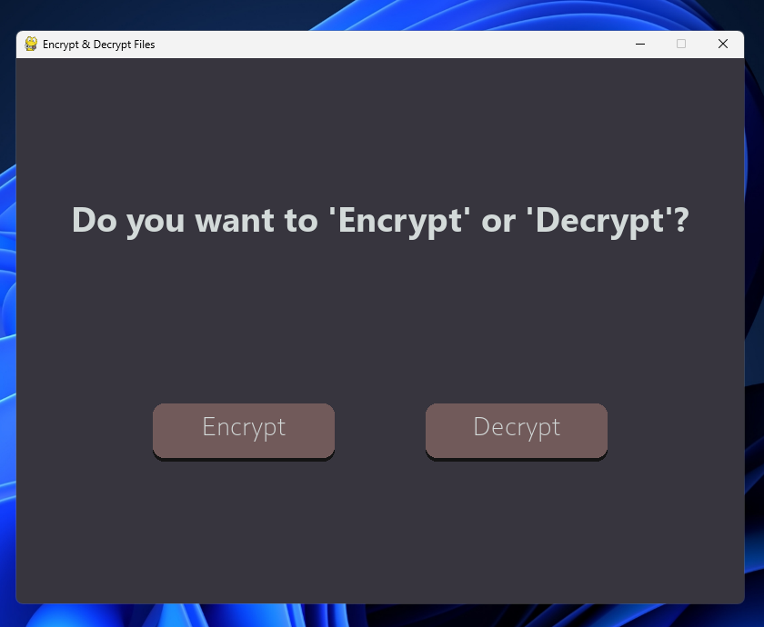

# 🔐 Encryptor — Secure File Encryption & Decryption with Python

**A Python-based file encryption application featuring authenticated encryption, a custom graphical user interface, clipboard integration, and automated tests.**

Encryptor is a desktop application that allows users to encrypt and decrypt files through an intuitive graphical interface. Built with Python, it combines the cryptographic capabilities of the `cryptography` library with a custom Pygame interface to make file encryption more accessible without sacrificing the underlying technical concepts.

The project was developed as my **CS50P final project** and is my first major step toward building practical software that brings together security, application logic, testing, and user experience.

Rather than limiting the project to a command-line script, I wanted to build a complete application: one that accepts user input, handles files, manages cryptographic keys, communicates results, and provides a consistent graphical workflow.

---

## 📸 Screenshots

### Home Screen


---

## ✨ Features

* 🔒 **Symmetric file encryption** — Encrypt files using Fernet, a high-level authenticated encryption system.
* 🔑 **Cryptographic key generation** — Generate a key required to decrypt the encrypted file.
* 🔓 **File decryption** — Restore encrypted files using the corresponding valid key.
* 🗑️ **Automatic original-file deletion** — After successful encryption, the application deletes the original file.
* 🖥️ **Custom graphical interface** — Navigate between encryption, decryption, file selection, and output screens through Pygame.
* 📋 **Clipboard integration** — Copy encryption keys and paste keys for decryption using `pyperclip`.
* ↩️ **Intuitive navigation** — Return to the home screen using back buttons and follow a consistent application layout.
* 🧪 **Automated tests** — Test core encryption and decryption functionality and check how the application handles errors.
* 📁 **File-based workflow** — Work with files directly instead of manually handling their contents in a terminal.

---

## ⚠️ Important Security Notice

**This application deletes the original file after successful encryption.**

This is an intentional part of the current implementation, but it introduces an important operational risk: if the encryption key is lost, the encrypted file may become unrecoverable.

Before using Encryptor on any real data:

* Test the application using disposable sample files.
* Keep a separate backup of any file you cannot afford to lose.
* Store generated encryption keys securely and separately from encrypted files.
* Never assume that copying a key to the clipboard is equivalent to securely backing it up.
* Understand that deleting a file through `pathlib.Path.unlink()` removes its filesystem entry but does **not** guarantee secure erasure of the underlying data.

This project is an educational implementation of file encryption, not a professionally audited security product. It has not been independently security-audited, and its file-deletion behavior should be considered carefully before use with important data.

---

## 🛠️ Technology Stack

The project uses a small set of focused Python libraries, each responsible for a distinct part of the application.

| Library               | Purpose                                                               |
| --------------------- | --------------------------------------------------------------------- |
| `cryptography`        | Fernet encryption, decryption, key generation, and authentication     |
| `pygame-ce`           | Graphical user interface, event handling, rendering, and navigation   |
| `pyperclip`           | Clipboard integration for copying and pasting encryption keys         |
| `pathlib`             | File-path handling and deletion of the original file after encryption |
| `unittest` / `pytest` | Automated testing of the application's core functionality             |

### Why these libraries?

**`cryptography`** handles the security-sensitive cryptographic operations through an established library rather than a custom encryption algorithm.

**Pygame** provides control over the application's layout, screen transitions, buttons, event handling, and visual feedback.

**Pyperclip** reduces friction when working with cryptographic keys, which can otherwise be cumbersome to copy and enter manually.

**Pathlib** provides a modern, readable interface for working with filesystem paths and performing file operations.

Together, these libraries allowed me to explore how cryptography, filesystem operations, testing, and user-interface design interact in a single application.

---

## 🔒 Encryption: How It Works

Encryptor uses **Fernet symmetric encryption** from the Python `cryptography` library.

Symmetric encryption uses the same secret key to encrypt and decrypt data. Anyone who obtains a valid key and the corresponding encrypted file may be able to recover the original contents, so key management is a critical part of the workflow.

Fernet provides authenticated encryption using:

* **AES-128-CBC** for encryption.
* **HMAC-SHA256** for message authentication and integrity verification.
* A timestamp and a cryptographically secure random initialization vector as part of its token format.

The application delegates these cryptographic operations to the Fernet implementation rather than implementing AES, HMAC, or key generation itself.

### The encryption workflow

1. The user selects a file through the graphical interface.
2. The application passes the selected file to `encrypt(file_name)`.
3. The function reads the file's contents and encrypts them using Fernet.
4. A new cryptographic key is generated for the encryption operation.
5. The encrypted output is written to a file.
6. After successful encryption, the original file is deleted using `pathlib`.
7. The generated key is returned to the application and can be copied through the **COPY** button.

The result is an encrypted file that can be decrypted later using the corresponding key.

### Why authenticated encryption matters

Encryption should protect more than confidentiality. It should also help detect unauthorized modification of encrypted data.

Fernet verifies the token's authentication information during decryption. If the token has been altered or the wrong key is supplied, decryption fails instead of returning unauthenticated plaintext.

This makes Fernet a practical choice for a project focused on learning how to use cryptography correctly through a high-level API.

---

## 🔓 Decryption: Recovering the Original File

The `decrypt(file_name, key)` function handles file decryption.

It accepts two parameters:

* **`file_name`** — The path to the encrypted file.
* **`key`** — The Fernet key corresponding to the encryption operation.

### The decryption workflow

1. The user selects an encrypted file.
2. The application provides a field for entering or pasting the encryption key.
3. The key is supplied to `decrypt(file_name, key)`.
4. The function attempts to decrypt and authenticate the encrypted contents.
5. If decryption succeeds, the recovered data is written to an output file.
6. The graphical interface presents the result to the user.

A correct key is essential. A missing, malformed, or incorrect key—or a modified or invalid Fernet token—can cause decryption to fail.

The original key should therefore be treated as essential recovery material. **There is no practical recovery mechanism if the required key is lost.**

---

## 🗑️ Automatic File Deletion

One of the defining design decisions in this version is the deletion of the original file after encryption.

The application uses Python's `pathlib` filesystem functionality to remove the original file after the encrypted output has been successfully created.

Conceptually, the operation follows this sequence:

**Read file → Encrypt contents → Write encrypted output → Delete original**

The ordering matters. The application should not delete the original before the encrypted output has been written successfully.

This behavior also highlights a distinction worth understanding in security engineering: deleting a file and securely erasing its contents are not the same thing. Filesystem journaling, storage-device behavior, snapshots, and backups can all affect whether deleted data remains recoverable.

For that reason, the deletion behavior is documented explicitly rather than being treated as a guarantee of secure data destruction.

---

## 🖥️ Graphical User Interface

The graphical interface was one of the most time-intensive parts of the project.

Instead of presenting encryption and decryption as isolated functions, I wanted to build an application that users could navigate naturally, with clear transitions between each stage of the workflow.

The interface is implemented in the `ui()` function using Pygame.

### Application flow

**1. Home screen**

The application begins with two primary options:

* **Encrypt** — Begin the file-encryption workflow.
* **Decrypt** — Begin the file-decryption workflow.

**2. File selection**

Both workflows lead to a file-upload or file-selection screen, allowing the user to select the file they want to process.

**3. Encryption output**

After encryption, the application displays the result and provides a **COPY** button for copying the generated key.

Because the original file is deleted after successful encryption, preserving this key is particularly important.

**4. Decryption key input**

During decryption, the user can enter or paste the corresponding Fernet key using the interface.

**5. Output and navigation**

The interface communicates the result of the operation and includes back buttons that allow users to return to the home screen.

### Design principles

The interface was built around a few straightforward principles:

* **Consistency:** Reuse layout patterns and navigation conventions across screens.
* **Clarity:** Keep the primary actions easy to identify.
* **Usability:** Reduce unnecessary manual work through clipboard integration.
* **Feedback:** Make the application's current stage and operation results understandable.
* **Separation of concerns:** Keep the user-facing workflow organized around encryption, decryption, and output handling.

The goal was not simply to make the cryptographic functions work, but to connect them into a usable desktop application.

---

## 📋 Clipboard Integration

Cryptographic keys are not ordinary text. They are essential inputs to the recovery process and must be handled carefully.

To simplify key handling, the application uses `pyperclip` to support copying and pasting through the system clipboard.

### Copying keys

After encryption, the user can click the **COPY** button to copy the generated key.

This avoids requiring the user to select and copy a long key manually.

### Pasting keys

During decryption, the user can paste the previously generated key into the input field.

This makes the process more convenient and reduces the chance of transcription errors.

Clipboard integration improves usability, but it does not replace secure key storage. Clipboard contents may be accessible to other applications, and the application does not constitute a dedicated key-management system.

---

## 🧪 Testing and Error Handling

The project includes a separate test file, `test_encryptor.py`, for testing the application's core functions.

Testing matters particularly in file encryption because a mistake can result in corrupted output or the loss of access to important data.

The test suite is intended to exercise the encryption and decryption logic and check how the application responds to potential errors.

Relevant cases for this type of application include:

* Encrypting a file and confirming that the encrypted output is produced.
* Decrypting an encrypted file with the correct key.
* Verifying that the recovered contents match the original contents.
* Handling an incorrect or invalid key.
* Handling invalid or modified encrypted data.
* Handling missing files and filesystem errors.
* Verifying the intended original-file deletion behavior.

The tests are maintained separately from the main application to make the core functionality easier to exercise without relying entirely on manual interaction with the graphical interface.

**Test coverage should be interpreted according to the cases actually implemented and passing in `test_encryptor.py`; the list above describes relevant cases, not a claim that every case is already covered.**

---


## 🛡️ VirusTotal & False-Positive Appeals

My final version of Encryptor has been flagged by multiple antivirus engines on [VirusTotal](https://www.virustotal.com/gui/file/043f8111df090fee0dee0646336f26d67323bb3076e08690faf524a176377f4e?nocache=1).

I'm actively appealing these detections to the respective security vendors, requesting further analysis to determine whether they are false positives. I'm also documenting the scan results to maintain transparency throughout the process.

These appeals are ongoing, and the detections have not yet been confirmed as false positives.

**My goal is to ensure my project is evaluated fairly while being transparent about its current security status.**


## 📦 Installation and Setup

### Prerequisites

* Python 3.10 or later is recommended.
* `pip` for installing dependencies.
* A supported desktop environment for running Pygame and accessing the clipboard.

### 1. Clone the repository

```bash
git clone https://github.com/aryanabid/encryptor.git
cd encryptor
```

### 2. Create a virtual environment

A virtual environment keeps the project's dependencies isolated from other Python projects.

**Windows — PowerShell**

```powershell
py -m venv .venv
.\.venv\Scripts\Activate.ps1
```

If the `py` command is unavailable, use your installed Python executable to create the environment.

### 3. Install the dependencies

If the repository includes `requirements.txt`, run:

```bash
python -m pip install -r requirements.txt
```

Otherwise, install the required packages directly:

```bash
python -m pip install cryptography pygame-ce pyperclip
```

### 4. Run the application

If the main application file is `encryptor.py`, run:

```bash
python encryptor.py
```

### 5. Run the tests

If the test suite uses `unittest`:

```bash
python -m unittest test_encryptor -v
```

Alternatively, if `pytest` is installed:

```bash
python -m pytest -q
```

Run the tests before relying on the application, particularly after changes to the encryption, decryption, or file-deletion logic.

---

## 🧠 Key Engineering Concepts Explored

This project brought several areas of software development together.

| Concept                      | Application in the project                                         |
| ---------------------------- | ------------------------------------------------------------------ |
| Symmetric cryptography       | Encrypting and decrypting file contents with Fernet                |
| Authentication and integrity | Detecting invalid or modified Fernet tokens                        |
| Filesystem operations        | Reading, writing, and deleting files                               |
| Function design              | Separating encryption and decryption logic into reusable functions |
| GUI programming              | Creating screens, processing events, and managing navigation       |
| Clipboard APIs               | Simplifying cryptographic key handling                             |
| Automated testing            | Checking core behavior independently of manual GUI use             |
| Error handling               | Accounting for invalid inputs and unsuccessful operations          |
| Dependency management        | Building on established Python libraries                           |

The most valuable aspect was learning how these pieces fit together in a complete application, rather than treating them as disconnected exercises.

---

## 💡 Motivation and Development

The initial inspiration came from browsing the CS50 community on Reddit, where I saw a project involving a 3D object viewer created for CS50x's final project.

That example prompted me to think beyond a basic command-line submission and build something with a more complete user experience.

I chose file encryption and decryption because the project offered an opportunity to combine Python fundamentals with a practical application of cryptography.

The development process involved more than writing the encryption functions. Building the interface, managing file operations, connecting the clipboard, handling errors, and organizing tests required thinking about how the application would behave as a whole.

As my first major project and my CS50P final project, Encryptor represents a practical application of the programming concepts I studied and an opportunity to explore the relationship between software functionality, usability, and security.

---

## 🚧 Potential Future Improvements

The project provides a foundation for further work. Areas worth exploring include:

* **Safer file handling:** Make deletion of the original file optional and require explicit confirmation.
* **Atomic output operations:** Use temporary files and carefully managed replacements to reduce the risk of partial output.
* **Key-management improvements:** Provide clearer key-saving guidance and reduce the risk of accidental key loss.
* **Expanded automated tests:** Add coverage for filesystem failures, malformed keys, corrupted tokens, and edge cases.
* **Improved error reporting:** Present actionable messages for common failures without exposing sensitive information.
* **Larger-file support:** Explore streaming or chunked encryption using an appropriate authenticated file-encryption design, since Fernet operates on data in memory.
* **Interface refinements:** Improve accessibility, keyboard navigation, responsiveness, and visual feedback.
* **Release packaging:** Provide reproducible builds and documented checksums for distributed executables.
* **Security review:** Review key handling, file-deletion semantics, and failure behavior before considering use with sensitive data.

These are possible directions for continued development, not claims that the current version already implements them.

---

## 📚 Acknowledgements

* **[CS50's Introduction to Programming with Python](https://cs50.harvard.edu/python/)** — For the Python concepts and project-based learning that provided the foundation for this application.
* **[Python `cryptography` documentation](https://cryptography.io/en/latest/)** — For the Fernet API and its cryptographic behavior.
* **[Pygame documentation](https://www.pygame.org/docs/)** — For GUI development and event handling.
* **[Pyperclip documentation](https://pyperclip.readthedocs.io/)** — For clipboard integration.
* The CS50 community on Reddit, whose project showcases helped inspire me to build something beyond the minimum requirements.
* **“Robotic Hand” icon** by Vinzence Studio, from [The Noun Project](https://thenounproject.com/), licensed under [CC BY 3.0](https://creativecommons.org/licenses/by/3.0/).


## 📄 License

This project is licensed under the MIT License. See the [LICENSE](LICENSE) file for details.


---

## 👨‍💻 Author

Built by **Aryan Abid** as my CS50P final project.

This project reflects my interest in Python development, practical cryptography, software design, and building applications that connect technical functionality with an accessible user experience.

If you explore the repository, feedback on the implementation, testing, and potential improvements is welcome.

**If you find the project interesting, consider giving the repository a ⭐ on GitHub.**

---

*Educational project. Not independently security-audited. Always keep backups and protect your encryption keys before processing important files.*
